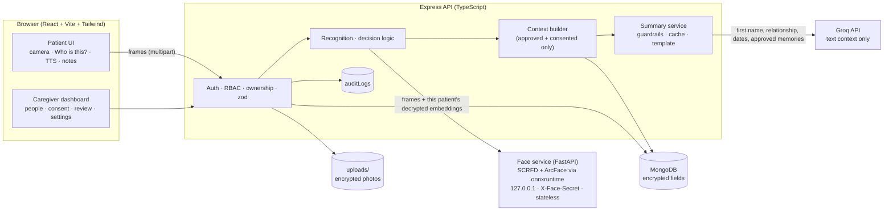

# Architecture

## Recognition sequence

1. The patient presses **Who is this?** The browser captures **5 frames, 350 ms apart**, and asks the visitor to turn their head a little.
2. Express loads this patient's people where consent is active, the scope includes `recognition`, and embeddings exist. It decrypts their embeddings in memory.
3. The face service, for each frame:
   - detects faces (SCRFD) and takes the largest;
   - aligns it to 112×112 using 5 landmarks;
   - computes an ArcFace 512-d embedding;
   - finds the best candidate by cosine similarity;
   - measures the yaw ratio.
4. `decision.service.ts`:
   - At least 3 of 5 frames must vote for the same person, each with score ≥ UNSURE and a margin of ≥ 0.05 over the runner-up.
   - The median score is compared with MATCH and UNSURE.
   - The liveness check (yaw range) must pass.
   - The outcome is match, unsure, unknown, no_face or liveness_failed.
5. **Match:** a visit is recorded or deduplicated. The context builder sends Groq the first name, relationship, last visits and approved memories, with a 3 s budget. The output is validated, and on any failure the template is used. The result is cached per context fingerprint.
6. **Unsure:** the patient hears "This may be Priya. Let's ask your caregiver to check." The visit waits for caregiver confirmation and is never used as context until confirmed.
7. The browser shows the card and speaks it (a `TTSProvider` using Web Speech), then reports timings to `/recognitions/:id/timing`.

Frames are never stored, by either service.

## Trust boundaries

| Boundary | Protection |
|---|---|
| Browser → API | Bearer JWT (memory only) and an httpOnly refresh cookie; zod; RBAC and ownership on every route; rate limits; CSP |
| API → face service | Localhost/private network, shared-secret header, timeout. The service is stateless and receives only one patient's candidates |
| API → Groq | Backend-only key, minimal text, guardrails, budget, timeout, template fallback |
| At rest | AES-256-GCM: embeddings, photos, notes, memories (with history). Hashed: passwords, refresh tokens, pairing codes |

## Request pipeline (Express)

`helmet (CSP) → CORS allow-list → JSON 100 kB → cookies → mongo-sanitize → rate limit → authenticate → requireRole → patientAccess (ownership) → zod validate → handler → audit`

## Code map

| Area | Files |
|---|---|
| Config | `server/src/config/env.ts` (every setting validated) |
| Security | `middleware/auth.ts`, `middleware/upload.ts`, `lib/crypto.ts`, `services/token.service.ts`, `services/pairing.service.ts` |
| Recognition | `routes/recognition.routes.ts`, `services/decision.service.ts`, `services/faceClient.service.ts`, `face-service/app/*` |
| AI | `services/context.service.ts`, `services/summary.service.ts`, `services/llm.service.ts`, `server/prompts/*.md` (versioned) |
| Patient UI | `client/src/pages/patient/*`, `client/src/tts/TTSProvider.ts`, `hooks/useCamera.ts`, `hooks/useSpeechInput.ts` |
| Caregiver UI | `client/src/pages/caregiver/*` |
| Evaluation | `routes/insights.routes.ts`, `face-service/eval/*`, `docs/evaluation.md` |
